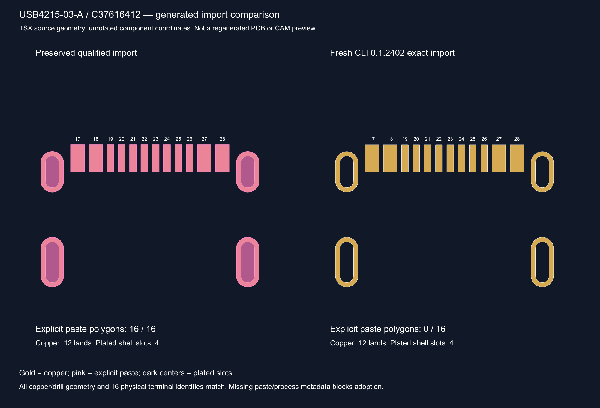

# Published toolchain update lacks capabilities from the qualified R8 local fixes

Status: **confirmed**. Classification: project/upstream integration qualification
gap. Existing distinct importer defects retain their original reports; this is
the update gate, not a claim that thirteen new bugs were discovered.

## Affected releases and components

tscircuit0.0.3008, CLI0.1.2402, easyeda0.0.381, props0.0.709,
core0.0.2199, CircuitJSON0.0.534, PnP0.0.20. Exact pins and npm integrity:
[release register](../evidence/R8-toolchain-refresh-2026-10-23/npm-releases.json).

- GCT USB4215-03-A / C37616412:
  [manufacturer](https://gct.co/connector/usb4215),
  [JLCPCB](https://jlcpcb.com/partdetail/C37616412).
- SHOUHAN MSK12C02 / C431540:
  [listing](https://jlcpcb.com/partdetail/MSK12C02/C431540),
  [manufacturer drawing](../references/SHOUHAN-MSK12C02.pdf).
- JST SM02B-SRSS-TB(LF)(SN)/C160402 and BM03B-SRSS-TB(LF)(SN)/C160389:
  [official SH catalogue](https://www.jst-mfg.com/product/pdf/eng/eSH.pdf).
- Complete25identity/C-number/input-path register:
  [components.json](../evidence/R8-toolchain-refresh-2026-10-23/components.json).

## Reproduction and input preservation

```sh
bun install --frozen-lockfile
cd evidence/R8-toolchain-refresh-2026-10-23/fresh
../../../node_modules/.bin/tsci import --jlcpcb --use-exact-footprint --download C37616412
../../../node_modules/.bin/tsci import --jlcpcb --use-exact-footprint --download C431540
cd ../../..
bun scripts/audit-r8-reimports.ts
bun test tests/r8-importer-release.test.ts
bun run typecheck
```

The remaining23commands, exact cwd, exit statuses and durations are in
[import-results](../evidence/R8-toolchain-refresh-2026-10-23/import-results.json).
Current supplier JSONs, original25TSX files, fresh25TSX+50model assets and complete
logs are preserved next to that register. No component or JSON was hand-edited.

## Expected behavior

An adoptable update must preserve the actual qualified footprint/pin/process
contracts or expose a documented equivalent that can be independently checked.
Supplier copper fidelity alone does not qualify paste, mask, SPDT behavior,
connector access or placement registration. Current supplier package
3104977db58742e399663286e4a66eac has16filled top-paste regions; the verified
qualified import has the corresponding12contact+4shell apertures. SPDT terminal2
selects1or3; shell4 is separate. USB verified insertion is `from_bottom` before
board rotation. Parent mask/paste choices and exact CPL registration are intentional
process controls in the unchanged R8 source, not disposable TypeScript errors.

## Actual results and measurements

- All25MPNs/pin tables/copper/drill geometries match **exactly**. USB retains
  four plated slots and16terminal features. No new supplier copper mismatch found.
- Fresh USB TSX has **zero explicit solderpaste elements versus16**. The live
  supplier payload still has16. Default renderer paste might exist later; it is
  not equivalent to demonstrated preservation of the exact stencil.
- Seven identities lose explicit pad paste/mask attributes; see comparison JSON.
- Three connectors become generic chips; USB loses explicit direction. JST
  direction was already absent in the old imports, a retained004 limitation.
- Slide switch becomes a generic chip with no `type="spdt"`; all three contacts
  and shell remain. A chip symbol cannot establish the switch's behavior.
- props0.0.709 rejects polygon solderpaste and parent mask/paste styles; PnP0.0.20
  lacks `registerSupplierTerminals`. TypeScript reports **28errors**.
- Exact release contracts: **1PASS/13FAIL**,89assertion calls. Auditor tests and
  prior38Python tests pass; these do not negate the failures.



The image is an inspected literal-TSX geometry comparison, not a native PCB,
3D or Gerber render. Actual logs and structured measurements:

- [Comparison JSON](../evidence/R8-toolchain-refresh-2026-10-23/geometry-comparison.json).
- [Failing contracts](../evidence/R8-toolchain-refresh-2026-10-23/importer-release-regression.log).
- [TypeScript errors](../evidence/R8-toolchain-refresh-2026-10-23/typecheck-final.log).
- [Import help](../evidence/R8-toolchain-refresh-2026-10-23/import-help.txt).

## Confirmed findings versus hypotheses

Current easyeda source-map excerpts process solid regions as cutouts/NPTH/document
features but do not preserve the tested paste regions. Standalone supported
easyeda0.0.381 reproduces the two critical omissions with the same saved supplier
inputs, so merely blaming the CLI's bundled copy is insufficient. props source
declares only rect/circle solderpaste. The public PnP declarations do not expose
the local registration API. These facts explain why the former locally qualified
toolchain cannot be replaced merely by changing version numbers.

No claim that the latest releases regressed previously shipped upstream behavior
is made: the baseline used local generic fixes. No new physical component defect,
manufacturer-process rejection, stock shortage or tolerance violation is established.

## Impact, retained issues and remaining fix

Unsafe to adopt imports, trust refreshed stencil/clearance/assembly output or
publish unchanged old CircuitJSON as a new build. Existing reports001,004,046,
060,073 and USB053/054/056 have current supplements instead of duplicate bug reports.

The startup dependency issue104 is fixed. Remaining source integration is **blocked**:
port and regression-test the preserved generic patches to current upstream, or
demonstrate an upstream release providing all capabilities. Regenerate imports
through the corrected supported pipeline, then run Linux board/render/export
qualification with the unchanged serial memory guard. Do not patch generated
components, remove the process controls or weaken tests to obtain a pass.

Changed project files are the pinned package/lock, static auditor, meaningful
audit/release/startup tests and review documentation. No supplier import replacement,
PCB source/routing/firmware/geometry change, new board version or fabrication release.


## Minimal standalone USB paste repro —2026-10-23

[Repro source](../repros/usb4215-paste-loss/README.md) and
[15KB ZIP](../deliverables/usb4215-paste-loss-repro.zip) isolate USB paste loss
without the full board, core/CLI, model downloads, local patches or routing.
The exact public easyeda0.0.381 API converts the frozen supplier input:16paste
regions→0, while12SMT pads and4plated slots remain. `bun run repro` must fail
with0!==16. The ZIP was extracted outside the repository and independently
installed using only its three pinned packages; the same expected exit1 is
confirmed in deliverables/usb4215-paste-loss-repro-verification.json.
No board source, active import, root dependency, existing evidence or CircuitJSON
was changed. This is a runnable reproduction, not a fix or manufacturing release.
